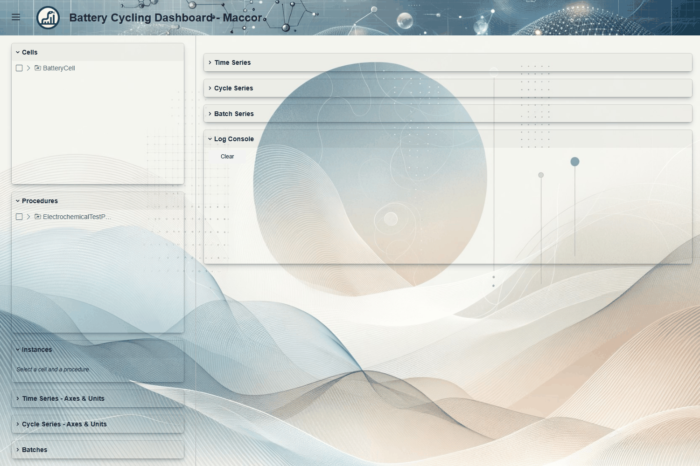
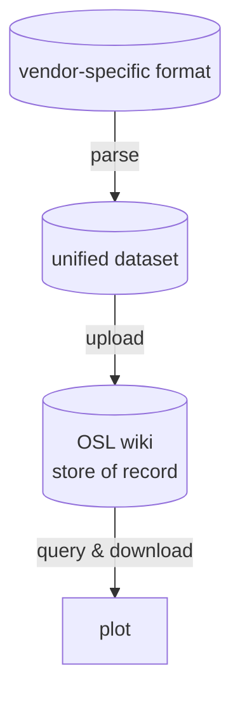
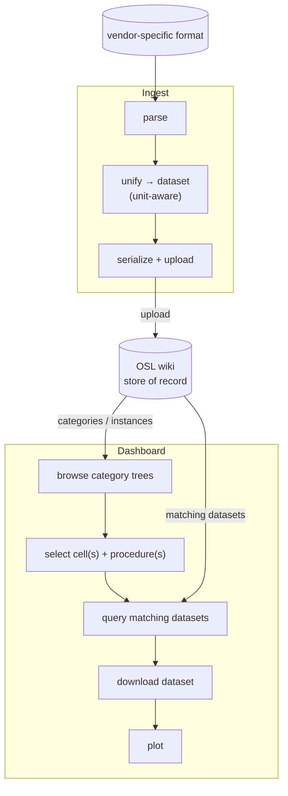
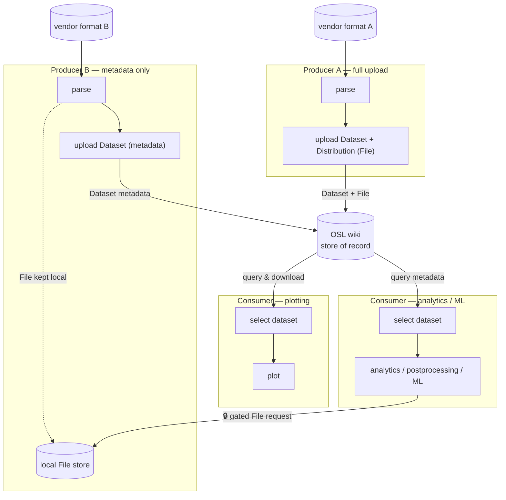

[](https://pypi.org/project/opensemantic.batteries/)
[](https://coveralls.io/r/OpenSemanticWorld-Packages/opensemantic.batteries)

# opensemantic.batteries

> Battery-domain Python models derived from the page package
> `world.opensemantic.batteries`, plus a typed, unit-aware battery cycling data
> model with cycler-file importers.

The package has three parts:

1. **Metadata models** - auto-generated Pydantic models (v1 and v2) for the
   battery domain: cells, modules and packs, cell formats and chemistries,
   electrode and electrolyte materials, electrochemical and mechanical tests,
   test procedures, and battery testing devices.
2. **Cycling data model** - the OSW-generated `ElectrochemicalCyclingDataset` /
   `CyclingDataRow` and `CyclingDatasetController`, which adds the pandas / pint
   round-trip and the file distribution handling, plus importers for real cycler
   export files (Maccor).
3. **Dashboard** (`opensemantic.batteries.view`) - a Panel / Bokeh dashboard
   that selects cells and procedures and plots time series, per-cycle
   capacities and coulomb efficiencies, and batch means with error bars. See
   [Dashboard (view)](#dashboard-view).



Builds on
[opensemantic.core](https://github.com/OpenSemanticWorld-Packages/opensemantic.core-python),
[opensemantic.base](https://github.com/OpenSemanticWorld-Packages/opensemantic.base-python),
[opensemantic.lab](https://github.com/OpenSemanticWorld-Packages/opensemantic.lab-python)
and
[opensemantic.characteristics.quantitative](https://github.com/OpenSemanticWorld-Packages/opensemantic.characteristics.quantitative-python).

## Data flow

Vendor cycler exports are parsed into a unified, unit-aware dataset, uploaded to
an OSL wiki (the shared store of record), then browsed, queried, downloaded and
plotted through the dashboard. The OSL wiki sits at the centre: ingestion
**writes** to it, the viewer **reads** from it.



### Detailed flow



### Multiple Users



Stage status today: **parse**, **unify**, **upload** and the read-side
**browse → query → download → plot** path all work. The upload is done by the
example scripts in `examples/osl/` (`upload_example_data_OSL.py` and
`upload_large_dataset_OSL.py`), not by a library function. Large datasets store
their rows in an uploaded `WikiFile` (JSON or CSV) that the dataset references
through its distributions, instead of inline in `Dataset.data`. The current
generated models drop the procedure link of a test, so the upload scripts use
temporary classes that keep it (the synthetic example data does the same); see
the known issue under
[Linking a test to its procedure](#linking-a-test-to-its-procedure).

## Installation

```bash
pip install opensemantic.batteries              # metadata models only
pip install opensemantic.batteries[maccor]      # + Maccor cycler-file import
pip install opensemantic.batteries[controller]  # + controller extras (via opensemantic.lab)
pip install opensemantic.batteries[view]        # + dashboard (opensemantic.lab[view], opensemantic.base[view])
pip install opensemantic.batteries[osl]         # + live OSL wiki backend (view and osw)
pip install opensemantic.batteries[docs]        # + demo media generation (playwright, imageio)
pip install opensemantic.batteries[testing]     # + test tools (pytest, pytest-cov, maccor)
```

Extras from `setup.cfg`:

- `maccor`: `maccor-utility`, needed by `read_maccor`.
- `controller`: `opensemantic.lab[controller]`.
- `view`: `opensemantic.lab[view]` and `opensemantic.base[view]`, needed by the
  dashboard.
- `osl`: `view` plus `osw`, needed to connect the dashboard to a live wiki.
- `docs`: `playwright`, `imageio`, `view` and `maccor`. Run
  `playwright install chromium` once after the installation.
- `testing`: `setuptools`, `pytest`, `pytest-cov` and `maccor`.

Two dependencies are temporary git pins: `opensemantic.base` is installed from
the `main` branch of its repository, and `maccor-utility` from a pinned commit.
See [Pending upstream fixes](#pending-upstream-fixes).

## Metadata models

The generated models mirror the OSW schema classes. Every model is an
`OswBaseModel`, so it carries an OSW identity (`uuid`, `type`) and can produce
its IRI - a *type* (e.g. `BatteryCellType`) resolves to a `Category:` IRI, a
concrete instance (e.g. `BatteryCell`) to an `Item:` IRI:

```python
import opensemantic.batteries as batteries        # Pydantic v2 models
import opensemantic.batteries.v1 as batteries_v1   # Pydantic v1 models

# A cell *type* (a Category) links a chemistry, form factor and format.
# "range" fields accept the linked object directly.
cell_type = batteries.BatteryCellType(
    label=[{"text": "18650 NMC"}],
    battery_chemistry=batteries.BatteryChemistry(
        label=[{"text": "Lithium-ion (NMC)"}]
    ),
    cell_form_factor=batteries.BatteryCellFormFactor(
        label=[{"text": "Cylindrical"}]
    ),
    cell_format=batteries.BatteryCellFormat(label=[{"text": "18650"}]),
)
cell_type.get_iri()                      # 'Category:OSW...'  (a type -> Category)
cell_type.battery_chemistry.get_iri()    # 'Item:OSW...'

# A concrete cell (an Item) with its electrode / electrolyte parts.
cell = batteries.BatteryCell(
    label=[{"text": "My 18650 cell #1"}],
    positive_electrode=batteries.Electrode(label=[{"text": "NMC cathode"}]),
    negative_electrode=batteries.Electrode(label=[{"text": "Graphite anode"}]),
    electrolyte=batteries.Electrolyte(label=[{"text": "LiPF6 in EC:DMC"}]),
)
cell.get_iri()                           # 'Item:OSW...'
cell.positive_electrode.get_iri()        # 'Item:OSW...'

# Linked ("range") fields serialise as IRI references:
cell_type.to_json()["battery_chemistry"]  # 'Item:OSW...'
```

`BatteryCellType` also exposes `positive_electrode` / `negative_electrode` /
`reference_electrode` / `electrolyte` / `separator` as electrode/material *type*
references (IRI strings), while `BatteryCell` carries the concrete `Electrode`,
`Electrolyte` and `Separator` parts.

### Available classes

Cells, modules and packs:
`BatteryCell`, `BatteryCellType`, `BatteryModule`, `BatteryPack`,
`BatteryModuleWithSensors`, `ElectrochemicalCell`,
`ElectrochemicalEnergyStorageDevice`, `EESD`, `EESDType`.

Formats and form factors:
`BatteryFormat`, `BatteryCellFormat`, `BatteryCellFormatType`,
`CoinCellFormat`, `CylindricalCellFormat`, `PouchCellFormat`,
`PrismaticCellFormat`, `SwagelockCellFormat`, `FormFactor`,
`BatteryCellFormFactor`.

Chemistry and materials:
`BatteryChemistry`, `ChemicalSystem`, `BatteryCellMaterial`,
`BatteryElectrodeMaterial`, `BatteryElectrolyteMaterial`, `Electrolyte`,
`ElectrolyteAdditive`, `Electrode`, `BatteryElectrodeType`, `CurrentCollector`,
`Separator`.

Tests, procedures and devices:
`ElectrochemicalTest`, `ElectrochemicalTestProcedure`, `BatteryTestProcedure`,
`BatteryStatePreparationTestProcedure`, `FormationTestProcedure`,
`PostMortemExperiment`, `BatteryCellOpening`, `BatteryCycler`,
`ElectrochemicalTestingDevice`.

(See `src/opensemantic/batteries/_model.py` for the full set of ~95 classes,
including the shared base and enumeration types.)

### Linking a test to its procedure

`ElectrochemicalTest.test_procedure` is a list of `TestProcedureItem`, and the
item references the procedure by its OSW IRI string (`procedure.get_iri()`),
not by the object:

```python
test = ElectrochemicalTest(
    label=[Label(text="Cell A - Formation")],
    test_procedure=[TestProcedureItem(test_procedure_instance=procedure.get_iri())],
    output=[dataset],
)
```

`BatteryDataView` resolves those IRIs back through `procedure_objects`; a
single `.protocol` object is still accepted as a legacy fallback. `output` is a
**list** of datasets, and the dashboard plots the first one's `.data`.

> **Known issue:** the currently generated `TestProcedureItem` has only
> `test_procedure_subcategory`. The fields `test_procedure_instance` and
> `test_procedure_instance_property` are missing, and Pydantic drops them
> without an error. Until the schema is fixed (see
> [Pending upstream fixes](#pending-upstream-fixes)), the code above creates a
> test without a procedure link. The non-lazy `BatteryDataView` then matches
> no data for that test, because it resolves the procedure through this
> field. The OSL dashboard also needs the link: its dataset query matches a
> test through
> `HasProcedure` (`[[-HasOutput.HasProcedure::...]]`), so a stored test
> without it is not found when a cell and a procedure are selected. The lazy
> and Maccor dashboards do not use this field.
>
> **Temporary fix:** `opensemantic.batteries` provides
> `LinkedTestProcedureItem` and `ProcedureLinkedElectrochemicalTest`
> (`src/opensemantic/batteries/_procedure_link.py`). They add the two fields
> with the definitions of the earlier generated model, so the link is stored.
> The synthetic example data (`examples/synthetic/battery_example_data.py`)
> and the upload scripts (`examples/osl/upload_example_data_OSL.py`,
> `examples/osl/upload_large_dataset_OSL.py` and
> `examples/dev/upload_multistage_dataset_OSL.py`) use them:
>
> ```python
> test = ProcedureLinkedElectrochemicalTest(
>     label=[Label(text="Cell A - Formation")],
>     test_procedure=[
>         LinkedTestProcedureItem(test_procedure_instance=procedure.get_iri())
>     ],
>     output=[dataset],
> )
> ```
>
> Remove the module and use the generated classes again once the schema ships
> the fields.

## Pydantic layers (v1 and v2)

Every generated model exists twice:

| import path | pydantic |
|---|---|
| `opensemantic.batteries` | v2 |
| `opensemantic.batteries.v1` | v1 |

They are separate class hierarchies, and mixing them fails: a v1 value passed
where a v2 model is expected does not validate. The subtle half is units -
**each layer has its own unit enums**. Passing a v2 `VoltageUnit` member to a
v1 value's `to_unit()` raises `UndefinedUnitError`, because the member is a
`str` subclass that the v1 code routes through its string branch and parses as
a unit name. That bug reached the dashboard once.

Pick one layer per module and stay in it. The dashboard, the examples and
`CyclingDatasetController` use **v1** throughout, matching the
`opensemantic.characteristics.quantitative.v1` values of the row fields; the
package root stays v2 like every other generated model there.

## Cycling data model

`ElectrochemicalCyclingDataset` holds its rows in `.data`, an ordered list of
`CyclingDataRow`. Each row field is a typed, unit-aware quantity, so the field
name stays unit-agnostic and the unit lives in the value:

| field | quantity | default unit | notes |
|---|---|---|---|
| `test_time` | Time | second | required |
| `voltage` | Voltage | volt | required |
| `current` | Electric current | ampere | required |
| `cycle_count`, `step_count` | Dimensionless | dimensionless | optional |
| `step_time` | Time | second | optional |
| `capacity` | Electric charge | coulomb | optional |
| `energy` | Energy | joule | optional |
| `step_type` | `StepType` enum | none | optional, only on `StepTypedCyclingDataRow` |

`step_type` is the operational mode of the step as reported by the cycler. It is
not part of the generated schema yet. `CyclingDatasetController` therefore uses
the local subclass `StepTypedCyclingDataRow`, which adds the field. The values
of `StepType` are `CC_CHG`, `CC_DCH`, `CV_CHG`, `CV_DCH`, `CCCV_CHG`,
`CCCV_DCH`, `REST`, `OCV`, `EIS` and `OTHER`. In the time-series plot,
`step_type` is a categorical axis (no unit, not usable as x).

> **Note.** `ElectrochemicalCyclingDataset` / `CyclingDataRow` are OSW-generated
> models from the schema package. Work with them through
> `CyclingDatasetController`, which carries the conversion methods. A `label` is
> required on the dataset.
>
> The controller is built on the **v1** models, matching the
> `opensemantic.characteristics.quantitative.v1` values of the row fields, so
> import the row class from `opensemantic.batteries.v1`. The package root stays
> v2, like every other generated model there.

```python
from opensemantic.batteries import CyclingDatasetController
from opensemantic.batteries.v1 import CyclingDataRow
from opensemantic.core.v1 import Label

ds = CyclingDatasetController(
    label=[Label(text="example")],
    data=[
        CyclingDataRow(
            test_time={"value": 0.0},
            voltage={"value": 3.0},
            current={"value": 0.0},
        ),
        CyclingDataRow(
            test_time={"value": 1.0},
            voltage={"value": 3.1},
            current={"value": 0.5},
        ),
    ],
)
```

### Importing cycler files

`read_maccor` parses a Maccor text / MIMS export into an
`ElectrochemicalCyclingDataset` (labelled with the source file name; requires the
`[maccor]` extra). The five formats produced by
[maccor-utility](https://github.com/OpenBattTools/maccor-utility) are supported
and detected from the file name; pass `fmt=` to override:

```python
from opensemantic.batteries import read_maccor

ds = read_maccor("cell_export2.024.txt")          # format detected from the name
ds = read_maccor("data.txt", fmt="maccor_export2")  # or set it explicitly
len(ds.data)
```

Supported formats: `maccor_export1`, `maccor_export2`, `mims_client1`,
`mims_client2`, `mims_server2`. To add another cycler, subclass `CyclerImporter`
and implement `to_dataframe()`.

The importer sets `step_type` from the Maccor `Mode` column. The code is
stripped and converted to upper case first (`MACCOR_MODE_TO_STEP_TYPE` in
`_importers/maccor.py`):

| `Mode` | `step_type` |
|---|---|
| `R` | `REST` |
| `C` | `CCCV_CHG` |
| `D` | `CC_DCH` |
| any other non-empty code | `OTHER` |
| empty | none |

### DataFrames (pandas + pint)

`ds.to_df()` yields a [pint-pandas](https://github.com/hgrecco/pint-pandas)
DataFrame (one column per field, unit carried by the dtype).
`CyclingDatasetController.from_df(df, label=...)` is the inverse; it maps columns
to the fixed `CyclingDataRow` schema (converting each to the field's default
unit) and **ignores** any extra column:

```python
from opensemantic.batteries import CyclingDatasetController

df = ds.to_df()
df["voltage"].dtype                       # pint[volt][Float64]

# unit-aware math on the frame; 'power' is not a row field, so it stays on the
# DataFrame only (from_df drops it)
df["power"] = df["voltage"] * df["current"]

enriched = CyclingDatasetController.from_df(df, label="derived")
```

Both methods come from `DatasetController` in `opensemantic.base`, so any
dataset with typed rows gets them.

### Serialisation

Compact JSON round-trip - `exclude_defaults` drops values left at their default
unit/type, leaving just the number, and the canonical units are restored on load:

```python
payload = enriched.to_json(exclude_defaults=True)
payload["data"][1]["voltage"]             # {'value': 3.1}

restored = CyclingDatasetController.from_json(payload)
restored.data[1].voltage.unit.name        # 'volt'
```

Unit-aware CSV - pint-pandas `dequantify()` writes a dedicated unit header line,
keeping the column keys unit-free:

```python
print(enriched.to_df().pint.dequantify().to_csv())
# ,test_time,voltage,current,...
# unit,second,volt,ampere,...
# 0,0.0,3.0,0.0,...
```

A runnable end-to-end example (import a Maccor file, derive a column, serialise,
re-import, export CSV) is in
[`examples/maccor/import_maccor.py`](examples/maccor/import_maccor.py).

## Dashboard (view)

`opensemantic.batteries.view` provides an interactive Panel/Bokeh dashboard,
`BatteryDataView`, for plotting cycling data, plus `OOLDTreeBuilder` for driving
its cell / procedure trees straight from Python objects. Units are switched via
the characteristics' own pint-backed `.to_unit()` (no hard-coded factor tables).

The sidebar has an **Instances** card that live-lists the test runs matching the
current cell + procedure selection; each has a checkbox so you can pick exactly
which datasets are plotted.

The view shows a single plot. It re-renders whenever the sidebar selection
changes: the selected cells, procedures, per-instance toggles, axis assignment
and unit choices.

Below the time-series plot, a collapsible **Cycle Series** card plots the
charge and discharge capacity and the two coulomb efficiencies per cycle for
each dataset. Its controls are in the sidebar card **Cycle Series - Axes &
Units**, a grid like the time-series one where y1 and y2 accept several fields
of one dimension (capacity or efficiency) with one unit per axis. It needs the
`step_type` of the rows and shows a placeholder without it.

The sidebar card **Batches** groups the plotted datasets into named
batches. **Cell batches** groups by the lowest category of the cell
and **Procedure batches** by the procedure; each dataset also has a
dropdown to move it to another batch or to "(none)", and a text field
adds a batch. A second collapsible card, **Batch Series**, plots the
mean of the capacities and efficiencies per cycle for each batch. The
error bars are the sample standard deviation and appear where at least
two datasets have a value for the cycle. Its controls are in the
sidebar card **Batch Series - Axes & Units**, the same grid as for the
cycle series.

The cycle table behind both plots is built by `cycle_summary` in
`_cycle_summary.py`, with these rules:

- A step is a run of consecutive rows with the same `cycle_count`,
  `step_count` and `step_type`.
- The charge capacity of a cycle is the sum of the capacity increases of its
  charge steps (`CC_CHG`, `CV_CHG`, `CCCV_CHG`). The discharge capacity is the
  same sum over the discharge steps (`CC_DCH`, `CV_DCH`, `CCCV_DCH`).
- The increase of a step is its last capacity minus a baseline. The baseline
  is the capacity of the row before the step if the step continues that counter
  (its first value is not below it), else zero (the cycler reset the counter).
- The discharge coulomb efficiency is discharge capacity divided by charge
  capacity, and the charge coulomb efficiency is the inverse. Each is `None`
  unless both capacities exist and the denominator is greater than zero.
- Without `step_type`, the cycle and batch plots show a placeholder that names
  the number of datasets without it.

In the batch plot, the value per cycle is the mean over the members of the
batch, and the error bar is the sample standard deviation (n - 1). A cycle with
one member has no error bar.

```bash
pip install opensemantic.batteries[view]
panel serve examples/synthetic/battery_dashboard.py --dev
```

```python
from opensemantic.batteries.view import BatteryDataView, OOLDTreeBuilder, PythonSource, has_type
```

See [`src/opensemantic/batteries/view/README.md`](src/opensemantic/batteries/view/README.md)
for the architecture (it extends `BaseDataView` from `opensemantic.base.view`),
the unit-conversion design, and the v1/v2 layer pitfall. Runnable examples:
[`examples/synthetic/battery_dashboard.py`](examples/synthetic/battery_dashboard.py) and
[`examples/synthetic/battery_tree_example.py`](examples/synthetic/battery_tree_example.py).

## Examples

Commands run from the repository root unless noted.

### Examples layout

| folder | contents |
|---|---|
| `examples/synthetic` | Synthetic data in memory, no credentials needed |
| `examples/maccor` | Real Maccor files from `tests/data`, no credentials needed |
| `examples/osl` | Scripts that connect to an OSL wiki, need `examples/accounts.pwd.yaml` |
| `examples/dev` | Personal scripts with local paths, not supported, see [`examples/dev/README.md`](examples/dev/README.md) |

### Credentials and wiki

`examples/accounts.pwd.yaml` is ignored by Git. Create it by copying
[`examples/accounts.pwd.yaml.template`](examples/accounts.pwd.yaml.template) and
fill in the user name and password. The OSL scripts read this file by default,
so they run from any directory, and they connect to the development wiki
`wiki-dev.open-semantic-lab.org`. The three command-line scripts
(`upload_example_data_OSL.py`, `upload_large_dataset_OSL.py` and
`osl_queries.py`) accept `--domain` and `--cred-filepath` to override both.
`battery_dashboard_OSL.py` takes no arguments, so change its connection in the
script.

### Dashboards

```bash
pip install -e ".[view]"

panel serve examples/synthetic/battery_dashboard.py --dev         # synthetic data
panel serve examples/maccor/battery_dashboard_maccor.py --dev  # real Maccor exports
panel serve examples/synthetic/battery_tree_example.py --dev      # tree only
panel serve examples/synthetic/battery_dashboard_lazy.py --dev    # lazily loaded trees

pip install -e ".[osl]"
panel serve examples/osl/battery_dashboard_OSL.py --dev     # trees + data from OSL
```

### Importing and converting

```bash
pip install -e ".[maccor]"

python examples/maccor/import_maccor.py          # cycler file -> dataset -> DataFrame
python examples/maccor/roundtrip_maccor_json.py  # dataset -> compact JSON -> dataset
```

### Working with OpenSemanticLab (OSL)

Both upload scripts are a dry run unless `--store` is passed.

```bash
pip install -e ".[osl,maccor]"   # maccor only needed by the large-dataset script
# the example tree: three cells, three procedures, six tests
python examples/osl/upload_example_data_OSL.py
python examples/osl/upload_example_data_OSL.py --store

# a large dataset, rows stored out-of-band in a WikiFile
python examples/osl/upload_large_dataset_OSL.py --dataset cell_c
python examples/osl/upload_large_dataset_OSL.py --dataset cell_d --store

# the same as CSV: the pint-pandas frame with its unit header row. After
# --store the rows are materialized back from the file as a round-trip check.
python examples/osl/upload_large_dataset_OSL.py --dataset cell_d --format csv --store

# the semantic searches the dashboard backend runs
python examples/osl/osl_queries.py                 # list the available queries
python examples/osl/osl_queries.py --query datasets
```

Both accept `--domain` and `--cred-filepath`; `--dataset` takes `cell_c`,
`cell_d` or `cell_e`, `--format` either `json` (typed values) or `csv`, and
`--query` one of `cell_subcategories`,
`cell_instances`, `procedure_subcategories`, `procedure_instances`,
`tests_of_cell`, `tests_of_cell_and_procedure` or `datasets`.

### Logging

The view and the OSL backend log to the logger
`opensemantic.batteries.view`. `LazyBatteryDataView(show_log=True)` shows a log
card with the recent records and a status line above the plots.
`examples/osl/battery_dashboard_OSL.py` sets the level from the environment
variable `OSB_VIEW_LOG` (default `INFO`). With `DEBUG`, the log also contains the
query texts.

## Development

```bash
pip install -e ".[testing,view,osl,maccor]"
pre-commit install                # run the hooks on every commit
pre-commit run --all-files        # run the hooks once on all files
```

### Tests

```bash
pytest                      # or: tox -e test (bare tox runs the same env)

# the OSL round-trip, opt-in because it writes to OSL
TEST_OSL_DOMAIN=wiki-dev.open-semantic-lab.org   TEST_OSL_CRED_FILEPATH=examples/accounts.pwd.yaml   pytest tests/test_dataset_distribution_wiki.py
```

Some tests skip when an optional package is missing: the view tests need
`panel` and `panelini` (extra `view`), the OSL backend tests need `panel`, the
wiki round-trip test needs `osw` (extra `osl`), and the Maccor import tests need
`maccor_utility` (extra `maccor`). `tests/test_dataset_distribution_wiki.py`
writes to a wiki and skips unless `TEST_OSL_DOMAIN` is set. `TEST_OSL_CRED_FILEPATH` is optional. It is
passed to the connection as the credentials file, and a failed connection also
skips the test.

## Pending upstream fixes

- **Vectorize `to_df` in `opensemantic.base`**: `DatasetControllerMixin.to_df`
  converts every value with its own `to_pint()` call, about 0.4 s for 2000 rows.
  The dashboard caches the frames per dataset, but the first plot after a
  selection is still slow. Fix: one pint array conversion per column.
- **Add `step_type` to the schema**: `CyclingDataRow` in
  `world.opensemantic.batteries` has no step mode. `_cycling.py` adds it with
  the local `StepType` enum and the `StepTypedCyclingDataRow` subclass. Once
  the schema ships `step_type`, regenerate the models, then remove the subclass
  and the `data` override on `CyclingDatasetController`. The JSON and CSV
  files keep working if the field name and the enum values stay the same.
  `CyclingDatasetController.from_df` also drops empty object columns, because
  the base `from_df` fails on them. Remove that guard once base handles them.
- **Add a cycle table to the schema**: `CycleDataRow`, `CycleSummaryDataset`
  and `cycle_summary` in `_cycle_summary.py` are a temporary local schema. Add
  the table to `world.opensemantic.batteries` in wide form (one row per cycle
  with `charge_capacity`, `discharge_capacity`, `charge_coulomb_efficiency` and
  `discharge_coulomb_efficiency`), regenerate the models, then remove the local
  module.
- **Restore the procedure link in `TestProcedureItem`**: the regenerated model
  has only `test_procedure_subcategory`. Add `test_procedure_instance` (the
  procedure's OSW IRI) and `test_procedure_instance_property` back to the
  `world.opensemantic.batteries` schema and regenerate, then remove the
  temporary `_procedure_link.py` module. Until then the synthetic example
  data and the upload scripts keep the test-to-procedure link only through
  the temporary classes, and tests built with the generated classes have no
  link (see
  [Linking a test to its procedure](#linking-a-test-to-its-procedure)).
  `docs/media/battery_dashboard.png` has not been regenerated since.
- **Release `opensemantic.base`**: `setup.cfg` installs it from the `main` branch
  of its repository, because `_cycling.py` needs the dataset controller that is
  merged but not released. Replace the git URL with `opensemantic.base>=0.43.0`
  or the first released version that contains it.
- **Release the `maccor-utility` fix**: `setup.cfg` pins `maccor-utility` to a git
  commit that contains the `TestTime` / `StepTime` duration-parsing fix (pull
  request OpenBattTools/maccor-utility#4). Repin to a released version once the
  pull request is merged and published.

Both git pins block a release to PyPI, because PyPI rejects dependencies that
are direct URLs.

## Note

The models in `src/opensemantic/batteries/_model.py` and
`src/opensemantic/batteries/v1/_model.py` are generated by the
[osw-python-package-generator](https://github.com/OpenSemanticWorld-Packages/osw-python-package-generator)
from the `world.opensemantic.batteries` schema package. Do not edit them
manually. The cycling data helpers (`_cycling.py`) and importers (`_importers/`)
are hand-written around those generated classes.

Hand-written extensions subclass or import the generated classes and live in
their own modules, so regeneration never touches them. Runtime dependencies
belong in `setup.cfg` (`[options] install_requires` and `extras_require`), not
in `pyproject.toml`: this is a PyScaffold `src/` layout with `find_namespace:`
discovery over the PEP 420 `opensemantic` namespace.
